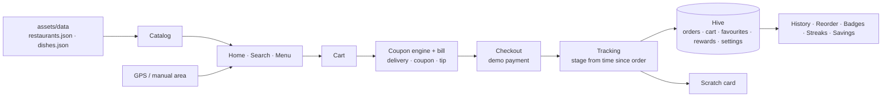
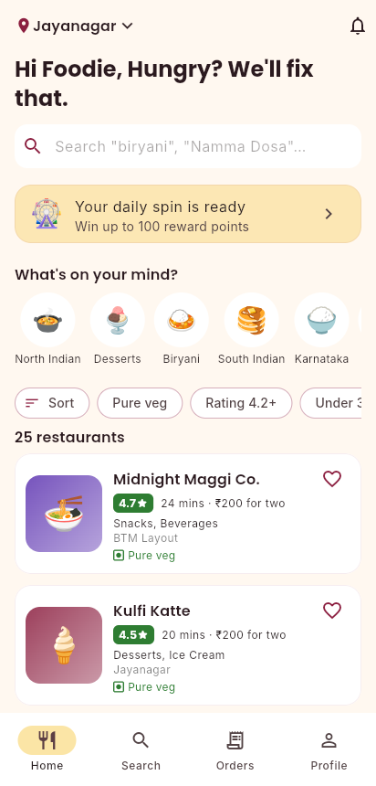
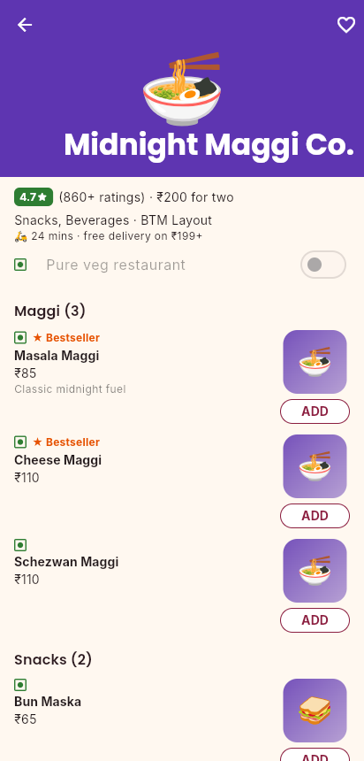
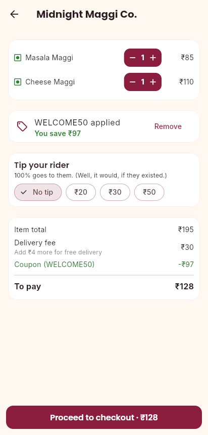
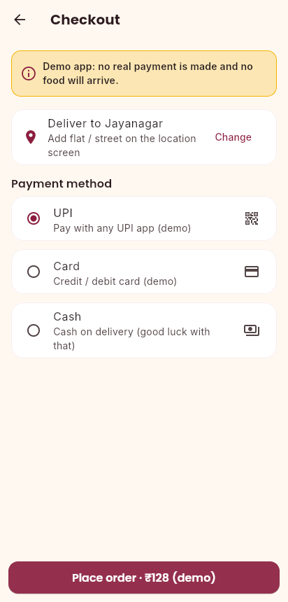
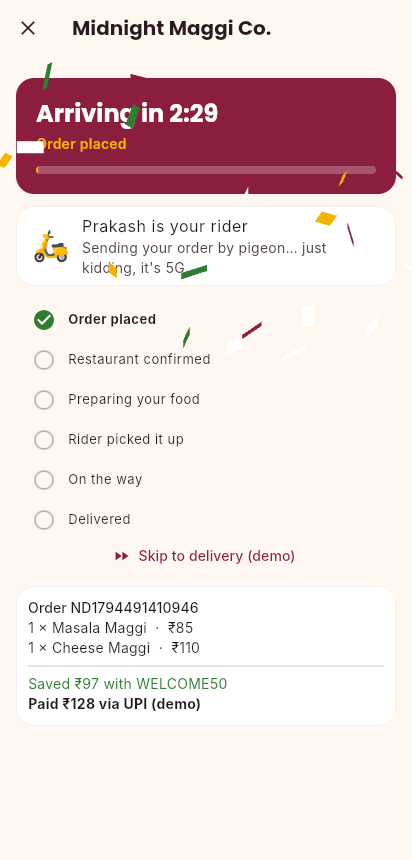
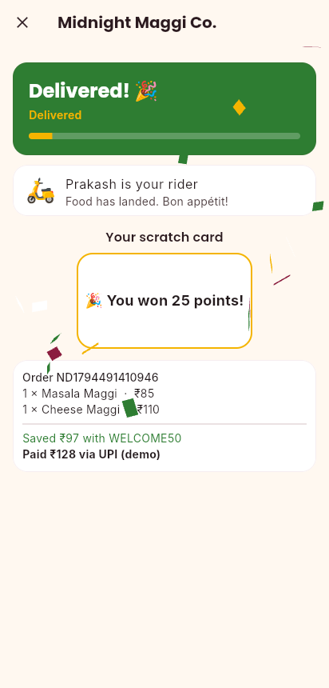

# Not Delivered

> Hungry? We'll fix that.

[](https://github.com/chiragparamesh/not_delivered/actions/workflows/build-apk.yml)

A fully offline food-delivery app for Bengaluru, built for fun. It has the whole ordering flow (browse, cart, coupons, checkout, live tracking) plus the delight features real apps use: confetti, scratch cards, streaks, badges and a daily spin wheel. Nothing is delivered and no money moves: payment is simulated and labelled as a demo.

## Features

| Feature | Status |
|---|---|
| Splash, 3-slide onboarding | ✅ Built |
| Location: GPS with manual area fallback (12 Bengaluru areas), delivery time by distance | ✅ Built |
| Home: cuisine chips, filters (pure veg, rating, under 30 mins, cost), sorting | ✅ Built |
| Search across restaurants, cuisines, areas and dishes | ✅ Built |
| Restaurant menu: sections, veg/non-veg marks, bestsellers, veg-only toggle, favourites | ✅ Built |
| Cart from one restaurant (replace-cart prompt), tip, live bill | ✅ Built |
| Coupon engine: 6 coupons, one at a time, with reasons when a coupon doesn't apply | ✅ Built |
| Checkout with simulated payment, clearly labelled as a demo | ✅ Built |
| Timer-based order tracking with funny messages ("Rider stuck at Silk Board…") | ✅ Built |
| Confetti + haptics on order | ✅ Built |
| Scratch card after delivery | ✅ Built |
| Rare "Not Delivered… just kidding!" easter egg (2% of orders) | ✅ Built |
| Order history with reorder | ✅ Built |
| Favourites, profile, notifications | ✅ Built |
| Savings counter, 7 badges, order streaks, reward points | ✅ Built |
| Daily spin wheel | ✅ Built |
| Everything stored offline in Hive | ✅ Built |

### Pricing rules

- Delivery fee: ₹30 below ₹199, free from ₹199.
- One coupon at a time. "First order" means order history is empty.

| Coupon | Rule |
|---|---|
| WELCOME50 | 50% off, max ₹100, min ₹149, first order only |
| FREEDEL199 | Free delivery, min ₹199 |
| FLAT20 | ₹20 off, min ₹300 |
| BIGFEAST | ₹75 off, min ₹600 |
| WEEKEND10 | 10% off, max ₹50 |
| SWEETTOOTH | ₹30 off, min ₹150, dessert/bakery restaurants only |

> Note: as written, FREEDEL199 never saves anything, because delivery is already free from ₹199. The app explains this when you try it. See docs/architecture.md for options.

## Architecture



Full design: [docs/architecture.md](docs/architecture.md).

## Tech stack

| Layer | Choice |
|---|---|
| App | Flutter (Dart), Material 3, Riverpod, go_router (bottom-nav shell) |
| Storage | Hive (hive_ce), JSON values, no code generation |
| Location | geolocator, behind a `LocationService` interface (fake in tests) |
| Fun | confetti package, CustomPainter scratch card and spin wheel, HapticFeedback |
| Design | Maroon `#8B1E3F`, gold `#F4B400`, background `#FFF8F0`; Poppins headings, Inter body (bundled, offline) |
| CI | GitHub Actions builds the release APK on every push |

## Data

`assets/data/restaurants.json` (25 restaurants) and `assets/data/dishes.json` (191 dishes) are **sample data**: fictional restaurants in real Bengaluru neighbourhoods. To use your own, keep the same fields (see `lib/features/catalog/domain/models.dart`).

## Tests

```bash
flutter test
```

Every coupon rule and boundary, the delivery fee threshold, bill maths, tracking timeline and easter egg, streaks and badges, GPS → nearest area, and two widget flows (first run → order → delivery → scratch card; returning user → reorder → profile).

## How to run

```bash
flutter pub get
flutter run -d chrome
```

Install on the phone: **Actions → Build APK → latest run → `not_delivered-release-apk`**. APKs are never built locally.

## Screenshots

| Home | Menu | Cart | Checkout | Tracking | Scratch card |
|---|---|---|---|---|---|
|  |  |  |  |  |  |

Fonts: Poppins and Inter, SIL Open Font License (`assets/fonts/OFL-*.txt`).
