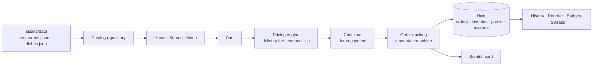

# Not Delivered

> Hungry? We'll fix that.

[](https://github.com/chiragparamesh/not_delivered/actions/workflows/build-apk.yml)

## Problem

Not really a problem: this is a fun project. It's a **fully offline** food-delivery app for Bengaluru with the full ordering flow (browse, cart, coupons, checkout, live tracking), plus the delight features real apps use: confetti, scratch cards, streaks and a spin wheel. Nothing gets delivered. Payment is simulated and clearly labeled as a demo.

## Features

| Feature | Status |
|---|---|
| Project skeleton, brand theme, routing, CI APK build | ✅ Built |
| Splash and onboarding | 🕓 Planned |
| Location (GPS with manual fallback) | 🕓 Planned |
| Home with cuisine chips and filters | 🕓 Planned |
| Search | 🕓 Planned |
| Restaurant menu | 🕓 Planned |
| Cart with coupons and tip | 🕓 Planned |
| Checkout with simulated payment (labeled demo) | 🕓 Planned |
| Timer-based order tracking with funny messages | 🕓 Planned |
| Order history with reorder | 🕓 Planned |
| Favorites, profile, notifications | 🕓 Planned |
| Confetti + haptics on order | 🕓 Planned |
| Scratch card after delivery | 🕓 Planned |
| Savings counter, badges and streaks | 🕓 Planned |
| Daily spin wheel | 🕓 Planned |
| Rare "Not Delivered… just kidding!" easter egg | 🕓 Planned |

### Pricing rules

- Delivery fee: ₹30 below ₹199, free from ₹199.
- One coupon at a time. "First order" means order history is empty.

| Coupon | Rule |
|---|---|
| WELCOME50 | 50% off, max ₹100, min ₹149, first order only |
| FREEDEL199 | Free delivery, min ₹199 |
| FLAT20 | ₹20 off, min ₹300 |
| BIGFEAST | ₹75 off, min ₹600 |
| WEEKEND10 | 10% off, max ₹50 |
| SWEETTOOTH | ₹30 off, min ₹150, dessert/bakery restaurants only |

## Architecture



Full design and roadmap: [docs/architecture.md](docs/architecture.md).

## Tech stack

| Layer | Choice |
|---|---|
| App | Flutter (Dart), Material 3, go_router |
| Storage | Hive (offline, local only) |
| Data | Bundled JSON in `assets/data/` |
| Design | Maroon `#8B1E3F`, gold `#F4B400`, background `#FFF8F0`; Poppins headings, Inter body |
| CI | GitHub Actions builds the release APK on every push |

## How to run

```bash
flutter pub get
flutter run -d chrome
```

Install on the phone: push to GitHub, open **Actions → Build APK → latest run**, download the `not_delivered-release-apk` artifact and install `app-release.apk` on the Pixel 9a. APKs are never built locally.

## Screenshots

_Coming soon._

| Home | Menu | Cart | Tracking |
|---|---|---|---|
| _todo_ | _todo_ | _todo_ | _todo_ |
