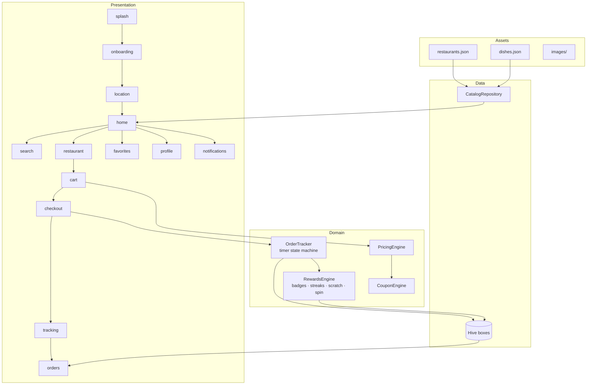

# Not Delivered — Architecture

## 1. Goal

A polished, fully offline food-delivery experience for Bengaluru. No network, no real payments, no real riders. All data is bundled JSON, and all state lives in Hive on the device.

## 2. Overview



## 3. Data model

**Assets:** `assets/data/restaurants.json` (25), `assets/data/dishes.json` (191). Currently generated sample data (fictional restaurants, real neighbourhoods); Chirag can swap in his own files with the same fields:

| Entity | Fields |
|---|---|
| Restaurant | `id`, `name`, `cuisines[]`, `category` (used for dessert/bakery), `rating`, `deliveryTimeMins`, `priceForTwo`, `area`, `lat`, `lon`, `image`, `isVeg` |
| Dish | `id`, `restaurantId`, `name`, `price`, `isVeg`, `category`, `description`, `image`, `bestseller` |

**Hive boxes:**

| Box | Contents |
|---|---|
| `settings` | onboarding done, saved location, theme |
| `cart` | restaurantId, lines (dishId, qty), coupon code, tip |
| `orders` | order snapshots: items, bill breakdown, status timeline, timestamps |
| `favorites` | restaurant/dish ids |
| `rewards` | savings total, badges, streak, last spin date, scratch cards |
| `notifications` | in-app notifications |

## 4. Pricing engine

```
itemTotal   = Σ dish.price × qty
deliveryFee = itemTotal >= 199 ? 0 : 30
discount    = coupon?.apply(itemTotal, deliveryFee, ctx) ?? 0
total       = itemTotal + deliveryFee − discount + tip
```

`ctx` holds: `isFirstOrder` (order history is empty), `isWeekend`, restaurant category.

| Code | Eligibility | Discount |
|---|---|---|
| WELCOME50 | first order, itemTotal ≥ 149 | min(50% × itemTotal, 100) |
| FREEDEL199 | itemTotal ≥ 199 | deliveryFee |
| FLAT20 | itemTotal ≥ 300 | 20 |
| BIGFEAST | itemTotal ≥ 600 | 75 |
| WEEKEND10 | — | min(10% × itemTotal, 50) |
| SWEETTOOTH | itemTotal ≥ 150, restaurant is dessert/bakery | 30 |

Rules: one coupon at a time; a coupon is re-validated whenever the cart changes, and if it no longer applies the cart shows why (it stays selected so it re-applies when the cart qualifies again); discount never exceeds the item total.

Decisions:
- **WEEKEND10** has no day restriction, because the brief gives none. Making it weekends-only is a one-line change in `evaluateCoupon`.
- **FREEDEL199** is implemented literally: it waives the delivery fee on orders of ₹199+, but delivery is already free from ₹199, so it never saves anything. The coupon sheet says "Delivery is already free on this order". Fix options: lower its minimum (e.g. ₹99), or raise the free-delivery threshold.

The engine is pure Dart with full unit tests for every boundary (₹148/₹149, ₹198/₹199, cap hits).

## 5. Order tracking

A timer-driven state machine (no backend):

```
placed → confirmed → preparing → picked_up → on_the_way → delivered
```

Stages start at 0, 8, 20, 60, 75 and 150 seconds (a short demo timeline; "Skip to delivery (demo)" jumps ahead). Funny messages are drawn per stage ("Rider stuck at Silk Board…"). A rare roll (2%) shows the **"Not Delivered… just kidding!"** easter egg before delivering. State is persisted, so the app can be killed and resumed: elapsed time is computed from timestamps.

On `delivered`: scratch card, savings counter update, streak/badge evaluation.

## 6. Platform features and web preview

| Feature | Android | Web (Chrome preview) |
|---|---|---|
| GPS location | geolocator | manual area picker fallback |
| Haptics | HapticFeedback | no-op |
| Hive | file storage | IndexedDB (supported) |
| Confetti | confetti package | works |

Platform-specific code sits behind interfaces in `lib/core/services/`.

## 7. Packages

`flutter_riverpod`, `go_router`, `hive_ce` + `hive_ce_flutter`, `confetti`, `geolocator`. Scratch card and spin wheel are custom painters (no extra packages). Fonts: Poppins and Inter bundled in `assets/fonts/` (offline).

## 8. Roadmap

| Phase | Scope |
|---|---|
| 0 ✅ | Skeleton, brand theme, router, CI APK build |
| 1 ✅ | Bundle fonts, catalog repository over the provided JSON, home + chips + filters, search, menu |
| 2 ✅ | Cart, pricing + coupon engine with tests, tip, checkout (demo payment banner) |
| 3 ✅ | Tracking state machine, order history, reorder, Hive persistence |
| 4 ✅ | Splash, onboarding, location, favorites, profile, notifications |
| 5 ✅ | Confetti, haptics, scratch card, savings counter, badges, streaks, spin wheel, easter egg |
| 6 | Polish: animations, empty states, accessibility, screenshots |
